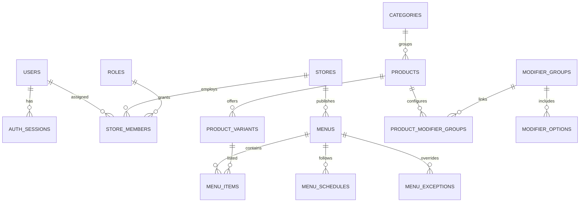
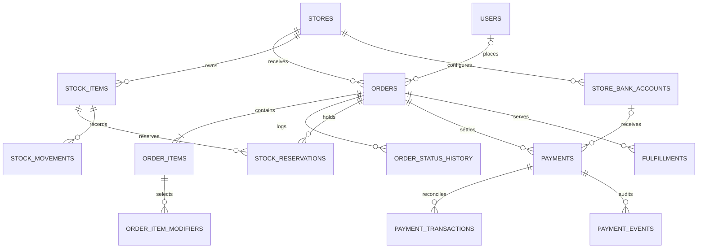
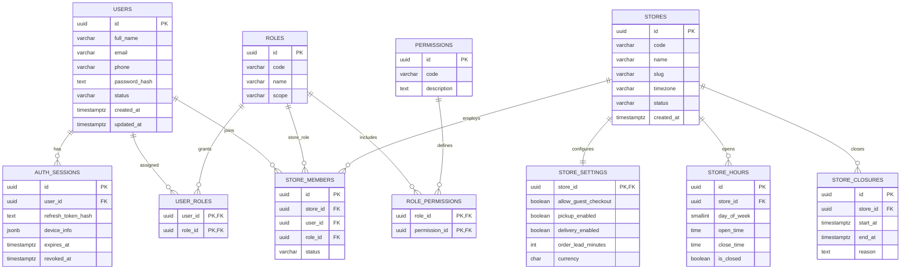
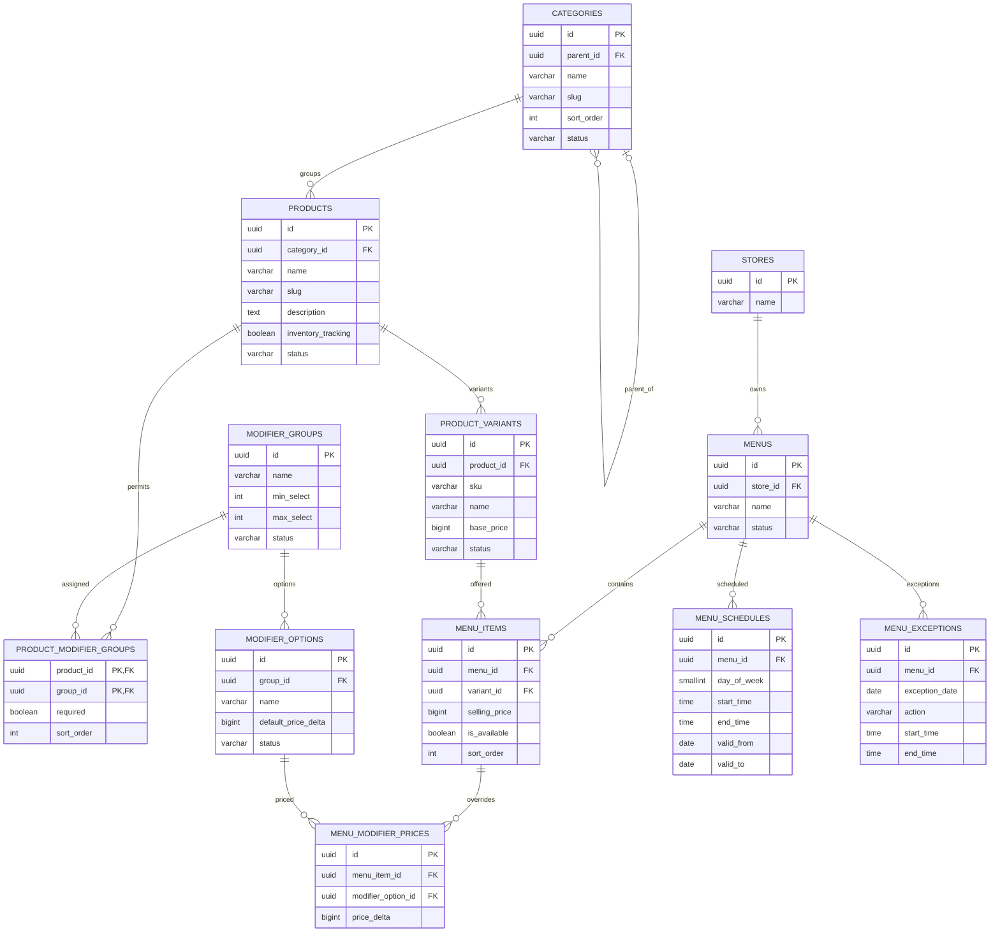
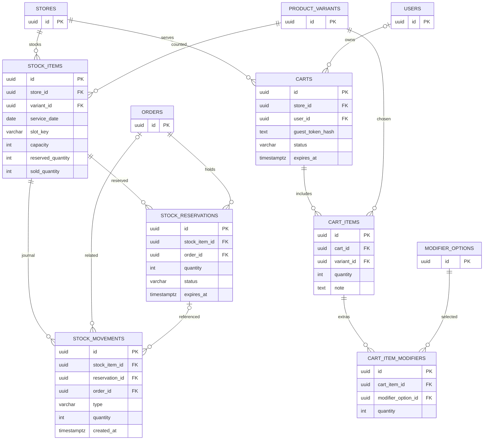
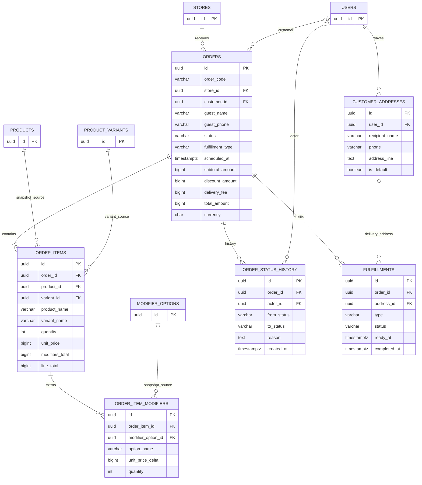
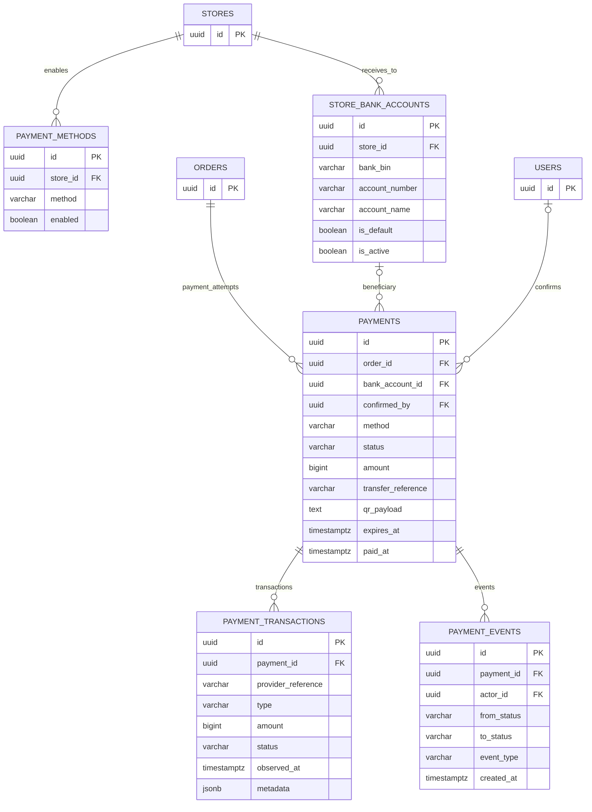
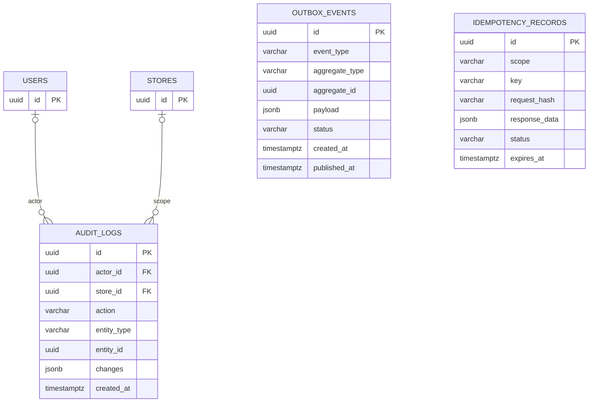

# SMART COMMERCE PLATFORM — DATABASE DESIGN SPECIFICATION

**Version:** 1.1  
**Status:** Proposed for implementation review  
**Database:** PostgreSQL  
**ORM:** Laravel Eloquent + Laravel migrations  
**Architecture:** Modular Monolith, multi-store ready, AI-ready  
**MVP payments:** Cash and bank transfer via dynamic VietQR, manually reconciled

> **Version 1.1 — ORM reconciliation.** Version 1.0 was written against Prisma.
> The approved backend is PHP/Laravel (`CLAUDE.md` §2), so §16 of `CLAUDE.md`
> requires the Prisma-specific *directions* in this document to be migrated to
> Eloquent and Laravel migrations. That has been done: §6, §8 and §11 below now
> describe the Laravel equivalents.
>
> The **schema design is unchanged** — tables, columns, keys, indexes,
> constraints, invariants, transaction boundaries and the payment workflow all
> stand exactly as reviewed. Only the implementation mechanism was restated.
> `docs/database/README.md` carries the full Prisma-to-Laravel mapping table.

## 1. Goals and assumptions

- One PostgreSQL database, with domain-owned tables; no microservice databases in MVP.
- Support multiple stores in the data model from day one, even if the initial rollout has one store.
- Customers may check out as guests; guest access to orders must be protected by a secure token/verification mechanism.
- Products are reusable catalog entities; menus determine availability, schedule and store-specific selling price.
- Inventory in MVP tracks sellable portions per store, product variant, service date and optionally service slot. Ingredient-level inventory is deferred.
- Cash is collected by staff; bank transfers use a unique order-specific reference and a generated VietQR payload. QR generation alone **does not** confirm payment.
- All monetary values are signed `BIGINT` representing whole VND, constrained nonnegative where applicable. All timestamps use `TIMESTAMPTZ` (UTC); schedules use local time and store timezone.
- Domain and API design should remain compatible with later AI tool calls, but no AI tables are required for MVP.

## 2. Domain ownership and table inventory

| Domain | MVP tables | Deferred/optional |
|---|---|---|
| Identity | `users`, `auth_sessions`, `roles`, `permissions`, `role_permissions`, `user_roles` | MFA factors |
| Stores | `stores`, `store_members`, `store_settings`, `store_hours`, `store_closures` | store groups |
| Catalog | `categories`, `products`, `product_variants`, `modifier_groups`, `modifier_options`, `product_modifier_groups` | product media, tags |
| Menus | `menus`, `menu_items`, `menu_schedules`, `menu_exceptions`, `menu_modifier_prices` | advanced price rules |
| Inventory | `stock_items`, `stock_reservations`, `stock_movements` | ingredients, recipes |
| Cart | `carts`, `cart_items`, `cart_item_modifiers` | saved carts |
| Orders | `orders`, `order_items`, `order_item_modifiers`, `order_status_history` | returns |
| Payments | `payment_methods`, `store_bank_accounts`, `payments`, `payment_transactions`, `payment_events` | automated reconciliation, refunds |
| Fulfillment | `fulfillments`, `customer_addresses` | courier integrations |
| Platform | `audit_logs`, `outbox_events`, `idempotency_records` | analytics aggregates |
| Later | — | `promotions`, `coupons`, `coupon_redemptions`, `ai_conversations`, `ai_messages`, `ai_tool_executions` |

## 3. Relationship diagrams

### 3.1 Store, identity, catalog and menu



### 3.2 Orders, stock and payments



## 3.3 Detailed Mermaid ERD — table columns and foreign keys

These diagrams are the **logical database ERD** for implementation. Types use PostgreSQL-oriented shorthand (`uuid`, `varchar`, `bigint`, `timestamptz`, `jsonb`). `PK` and `FK` are explicitly annotated. For composite primary keys and partial unique indexes, see the detailed definitions and migration constraints below. Optional foreign keys are described in the data dictionary. Diagrams are split by bounded context for readability; cross-domain links are represented in the relevant diagram.

### 3.3.1 Identity and Stores



### 3.3.2 Catalog and Menu



### 3.3.3 Inventory and Cart



### 3.3.4 Orders and Fulfillment



### 3.3.5 Payments — Cash and VietQR



### 3.3.6 Platform — Audit, Outbox and Idempotency



**Important:** `outbox_events.aggregate_id` and `audit_logs.entity_id` are polymorphic references, **not physical foreign keys**. Mermaid therefore intentionally does not draw a relationship to arbitrary aggregate tables. Payment and order snapshot fields must survive edits to catalog or beneficiary account data. `customer_addresses` and `fulfillments` are optional MVP modules: if implemented, finalize delivery address snapshots and fields before migration. The diagrams show the primary columns, while section 4 and the migration DDL remain authoritative for full constraints, defaults, nullability, and additional timestamps.

---

## 4. Detailed table definitions

**Conventions:** `id UUID PRIMARY KEY`, `created_at TIMESTAMPTZ NOT NULL DEFAULT now()`, `updated_at TIMESTAMPTZ NOT NULL` are present on mutable core tables unless noted. FK references use `RESTRICT` for financially significant history; avoid cascading deletes of transactional data. PostgreSQL enums or constrained text are acceptable; keep naming consistent.

### 4.1 Identity

- **users**: `id`, `full_name VARCHAR(150)`, `email VARCHAR(255) NULL`, `phone VARCHAR(20) NULL`, `password_hash TEXT NULL`, `status` (`ACTIVE`, `BLOCKED`), timestamps. Unique normalized email/phone where not null; login accounts must have at least one verified credential path. Do not create a user for every guest order.
- **auth_sessions**: `id`, `user_id FK`, `refresh_token_hash TEXT`, `device_info JSONB NULL`, `expires_at`, `revoked_at NULL`, `created_at`. Never store raw refresh tokens.
- **roles**: `id`, `code UNIQUE`, `name`, `scope` (`GLOBAL`, `STORE`).
- **permissions**: `id`, `code UNIQUE`, `description`.
- **role_permissions**: composite unique `(role_id, permission_id)`.
- **user_roles**: composite unique `(user_id, role_id)` for **global** roles only. Store-scoped roles belong in `store_members`.

### 4.2 Stores

- **stores**: `id`, `code VARCHAR(30) UNIQUE`, `name VARCHAR(200)`, `slug VARCHAR(200) UNIQUE`, `phone`, `address`, `timezone VARCHAR(64) DEFAULT 'Asia/Ho_Chi_Minh'`, `status` (`ACTIVE`, `INACTIVE`), timestamps.
- **store_members**: `id`, `store_id FK`, `user_id FK`, `role_id FK` (store-scoped), `status`, timestamps; unique `(store_id, user_id)` for one active membership model.
- **store_settings**: `store_id PK/FK`, `allow_guest_checkout BOOLEAN`, `pickup_enabled BOOLEAN`, `delivery_enabled BOOLEAN`, `order_lead_minutes INT`, `currency CHAR(3) DEFAULT 'VND'`, `updated_at`.
- **store_hours**: `id`, `store_id FK`, `day_of_week SMALLINT` (ISO 1–7), `open_time TIME`, `close_time TIME`, `is_closed BOOLEAN`; support overnight schedules explicitly if needed.
- **store_closures**: `id`, `store_id FK`, `start_at`, `end_at`, `reason`.

### 4.3 Catalog and customization

- **categories**: `id`, `parent_id FK NULL`, `name`, `slug`, `sort_order`, `status`.
- **products**: `id`, `category_id FK`, `name`, `slug`, `description`, `status`, `inventory_tracking BOOLEAN`, timestamps. Add optional structured dietary/allergen tags only when verified and maintained.
- **product_variants**: `id`, `product_id FK`, `sku UNIQUE NULL`, `name`, `base_price BIGINT`, `status`, `sort_order`, timestamps; `base_price >= 0`.
- **modifier_groups**: `id`, `name`, `min_select INT`, `max_select INT`, `status`; check `0 <= min_select <= max_select`.
- **modifier_options**: `id`, `group_id FK`, `name`, `default_price_delta BIGINT`, `status`, `sort_order`.
- **product_modifier_groups**: `product_id FK`, `group_id FK`, `required BOOLEAN`, `sort_order`; unique `(product_id, group_id)`.

For store-specific catalogs, enforce visibility through menu membership. If future stores require independent product ownership, add an explicit catalog ownership model rather than silently reusing another merchant's products.

### 4.4 Menus and schedules

- **menus**: `id`, `store_id FK`, `name`, `status` (`DRAFT`, `ACTIVE`, `ARCHIVED`), timestamps.
- **menu_items**: `id`, `menu_id FK`, `variant_id FK`, `selling_price BIGINT`, `is_available BOOLEAN`, `sort_order`, timestamps. Unique `(menu_id, variant_id)` for a simple menu. `selling_price >= 0`.
- **menu_schedules**: `id`, `menu_id FK`, `day_of_week SMALLINT` (1–7), `start_time TIME`, `end_time TIME`, `valid_from DATE NULL`, `valid_to DATE NULL`; check schedule validity; decide policy for overnight periods.
- **menu_exceptions**: `id`, `menu_id FK`, `exception_date DATE`, `action` (`CLOSED`, `OPEN`), `start_time TIME NULL`, `end_time TIME NULL`, `reason`; define priority over recurring schedule.
- **menu_modifier_prices**: `id`, `menu_item_id FK`, `modifier_option_id FK`, `price_delta BIGINT`, unique `(menu_item_id, modifier_option_id)`; optional override; validate option belongs to an allowed group for the product.

**Availability calculation:** store active + store opening/closure rules + menu status + local service date/time + schedule exceptions + active variant + menu item available + sufficient inventory. Scheduled orders evaluate at **requested fulfillment time**. A menu's being visible does not guarantee stock; revalidate at checkout.

### 4.5 Portion inventory

- **stock_items**: `id`, `store_id FK`, `variant_id FK`, `service_date DATE`, `slot_key VARCHAR(64) DEFAULT 'ALL_DAY'`, `capacity INT`, `reserved_quantity INT DEFAULT 0`, `sold_quantity INT DEFAULT 0`, `updated_at`; unique `(store_id, variant_id, service_date, slot_key)`. Check `capacity >= 0`, `reserved_quantity >= 0`, `sold_quantity >= 0`, `reserved_quantity + sold_quantity <= capacity`.
- **stock_reservations**: `id`, `stock_item_id FK`, `order_id FK`, `quantity INT`, `status` (`ACTIVE`, `CONSUMED`, `RELEASED`, `EXPIRED`), `expires_at`, timestamps; unique `(stock_item_id, order_id)` if one reservation per stock item per order.
- **stock_movements**: `id`, `stock_item_id FK`, `reservation_id FK NULL`, `order_id FK NULL`, `type` (`CAPACITY_ADJUST`, `RESERVE`, `CONSUME`, `RELEASE`, `CORRECTION`), `quantity INT`, `reason`, `actor_id FK NULL`, `created_at`.

`available = capacity - reserved_quantity - sold_quantity`. Reserve atomically with conditional `UPDATE ... WHERE capacity - reserved_quantity - sold_quantity >= :qty RETURNING id`, in the same DB transaction as order creation. For cash orders, define whether stock is immediately consumed or held until confirmation; the default recommendation is reserve at order creation, consume at confirmation, and release on timely cancellation. Set expiration policies carefully so confirmed/preparing orders are not released accidentally.

### 4.6 Cart

- **carts**: `id`, `store_id FK`, `user_id FK NULL`, `guest_token_hash TEXT NULL`, `status` (`ACTIVE`, `CHECKED_OUT`, `EXPIRED`), `expires_at`, timestamps.
- **cart_items**: `id`, `cart_id FK`, `variant_id FK`, `quantity INT`, `note TEXT NULL`, timestamps. Do not trust cart price at checkout.
- **cart_item_modifiers**: `id`, `cart_item_id FK`, `modifier_option_id FK`, `quantity INT DEFAULT 1`.

### 4.7 Orders

- **orders**: `id`, `order_code VARCHAR(32) UNIQUE`, `store_id FK`, `customer_id FK NULL`, `guest_name NULL`, `guest_phone NULL`, `status` (`PENDING_PAYMENT`, `PLACED`, `CONFIRMED`, `PREPARING`, `READY`, `COMPLETED`, `CANCELLED`, `EXPIRED`), `fulfillment_type` (`PICKUP`, `DELIVERY`), `scheduled_at NULL`, `subtotal_amount BIGINT`, `discount_amount BIGINT DEFAULT 0`, `delivery_fee BIGINT DEFAULT 0`, `total_amount BIGINT`, `currency CHAR(3) DEFAULT 'VND'`, `note`, timestamps. Check all monetary components nonnegative and totals consistent in the pricing use case; enforce further constraints in DB where practical.
- **order_items**: `id`, `order_id FK`, `product_id FK`, `variant_id FK`, `product_name VARCHAR(200)`, `variant_name VARCHAR(100)`, `quantity INT`, `unit_price BIGINT`, `modifiers_total BIGINT`, `line_total BIGINT`, `note NULL`. Snapshot all display/price fields at order time.
- **order_item_modifiers**: `id`, `order_item_id FK`, `modifier_option_id FK NULL`, `option_name VARCHAR(200)`, `unit_price_delta BIGINT`, `quantity INT`.
- **order_status_history**: `id`, `order_id FK`, `from_status NULL`, `to_status`, `actor_id FK NULL`, `reason`, `created_at`.

**Order status != payment status.** Cash orders can be `PLACED` with payment `PENDING`. Bank transfer orders default to `PENDING_PAYMENT` until manually verified. `COMPLETED` does not automatically imply `PAID`.

### 4.8 Payment — MVP cash and VietQR

- **payment_methods**: `id`, `store_id FK`, `method` (`CASH`, `BANK_TRANSFER`), `enabled BOOLEAN`; unique `(store_id, method)`.
- **store_bank_accounts**: `id`, `store_id FK`, `bank_bin VARCHAR(12)`, `account_number VARCHAR(50)`, `account_name VARCHAR(200)`, `is_default BOOLEAN`, `is_active BOOLEAN`, timestamps. Partial unique index: max one active default per store. Restrict edit permissions and audit changes.
- **payments**: `id`, `order_id FK`, `method`, `status` (`PENDING`, `PROCESSING`, `PAID`, `FAILED`, `PARTIALLY_REFUNDED`, `REFUNDED`), `amount BIGINT`, `bank_account_id FK NULL`, `transfer_reference VARCHAR(32) UNIQUE NULL`, `qr_payload TEXT NULL`, `expires_at NULL`, `paid_at NULL`, `confirmed_by FK NULL`, timestamps. Snapshot beneficiary bank details used for the QR so later account edits cannot alter historical payment instructions.
- **payment_transactions**: `id`, `payment_id FK`, `provider_reference VARCHAR(128) NULL`, `type` (`RECEIPT`, `REFUND`, `ADJUSTMENT`), `amount BIGINT`, `status`, `observed_at`, `created_at`, `metadata JSONB NULL`; deduplicate provider references when supplied.
- **payment_events**: `id`, `payment_id FK`, `event_type`, `previous_status`, `new_status`, `actor_id FK NULL`, `reason`, `created_at`.

**VietQR workflow:** create order and pending payment; select store bank account; generate unique transfer reference; generate EMV-compatible VietQR content/image from beneficiary bank, account, amount and reference; display to customer; staff verify actual bank receipt; staff confirmation updates payment and order transactionally, with audit and outbox event. Do not mark paid based on a customer click, screenshot or QR creation. Automatic webhook-based bank reconciliation is deferred.

**Exception cases:** underpayment, overpayment, incorrect reference, duplicate transfer, payment after expiration, cancellation after receipt, payment-method change. Keep an explicit reconciliation/manual resolution workflow. Never blindly auto-match on amount alone.

### 4.9 Fulfillment

- **fulfillments**: `id`, `order_id FK`, `type`, `status` (`PENDING`, `PREPARING`, `READY`, `DISPATCHED`, `DELIVERED`, `CANCELLED`), `scheduled_at NULL`, `ready_at NULL`, `completed_at NULL`, `delivery_address_snapshot JSONB NULL`, timestamps.
- **customer_addresses**: `id`, `user_id FK`, `recipient_name`, `phone`, `address_text`, `is_default`, timestamps. For guests, snapshot delivery address in order/fulfillment instead.

### 4.10 Operational infrastructure

- **audit_logs**: `id`, `store_id FK NULL`, `actor_id FK NULL`, `action`, `entity_type`, `entity_id`, `changes JSONB`, `request_id`, `created_at`. Redact passwords, tokens, secrets and unnecessary personal data.
- **outbox_events**: `id`, `aggregate_type`, `aggregate_id`, `event_type`, `payload JSONB`, `status` (`PENDING`, `PUBLISHED`, `FAILED`), `attempts`, `created_at`, `published_at NULL`. Insert in the same transaction as the domain mutation. Consumer jobs must be idempotent.
- **idempotency_records**: `id`, `scope`, `key`, `request_hash`, `status`, `response_status`, `response_body JSONB NULL`, `expires_at`, `created_at`; unique `(scope, key)`. Reject reuse of a key with a different request hash.

## 5. Core business invariants

1. Client-provided price is never authoritative. Reprice on checkout using menu/variant/modifier rules.
2. A cart/order belongs to one store in MVP; do not mix products from different stores in one order.
3. Orders retain immutable product/variant/modifier names and price snapshots.
4. The same stock unit cannot be sold twice. All reservations and conversions are atomic.
5. Order transitions follow a validated state machine; each transition writes history.
6. Payment status is independent of order status; manual confirmation is permission-controlled and audited.
7. Payment confirmation and corresponding business event must commit atomically.
8. Every store-scoped query checks store membership/authorization; never trust a client-supplied `store_id` alone.
9. Bank account changes cannot silently alter an existing payment QR/beneficiary snapshot.
10. All dates for menu schedules and portion caps are evaluated in the store's configured timezone.

## 6. Critical indexes and constraints

```sql
CREATE INDEX idx_orders_store_created ON orders (store_id, created_at DESC);
CREATE INDEX idx_orders_store_status ON orders (store_id, status);
CREATE INDEX idx_menu_items_menu ON menu_items (menu_id);
CREATE INDEX idx_payments_order_status ON payments (order_id, status);
CREATE INDEX idx_stock_reservations_expiry ON stock_reservations (expires_at) WHERE status = 'ACTIVE';
CREATE UNIQUE INDEX uq_active_default_bank_account ON store_bank_accounts (store_id)
  WHERE is_default = TRUE AND is_active = TRUE;
```

These are illustrative SQL statements; migration order, enum representation and exact names must match the committed Laravel migrations. Laravel's schema builder cannot express partial indexes or CHECK constraints, so those are written as raw SQL inside a reviewed migration — the justified use of raw SQL the conventions allow. Index foreign keys and high-cardinality store/date filters based on query plans. Add constraints for positive quantities, nonnegative prices and stock invariants.

## 7. Transaction boundaries and concurrency

**Create order:** validate idempotency key; read authoritative menu/price; transactionally reserve stock, insert order/items/payment intent, write status history and outbox; commit. Handle serialization/retry and unique conflicts safely.

**Confirm cash receipt:** permission-check cashier; lock payment/order; validate current state and amount; mark payment `PAID`; append event/audit; commit. Do not infer receipt from `COMPLETED`.

**Confirm bank receipt:** permission-check authorized staff; record bank evidence/reference and received amount; lock payment; verify no prior confirmation; mark `PAID` only on verified exact settlement or approved exception; update order according to workflow; write audit/outbox; commit.

**Expire unpaid order:** worker identifies eligible expired orders, locks rows, confirms not already paid/confirmed, releases active reservations, transitions order to `EXPIRED`, writes outbox. Handle late payments through reconciliation rather than reopening automatically.

## 8. Eloquent and Laravel migration guidelines

- PostgreSQL `snake_case` tables and columns throughout. Eloquent maps them directly, so no attribute aliasing is needed; where a PHP-side name must differ, use an accessor rather than renaming the column.
- `$table->timestampsTz()` / `timestampTz()` for timestamps (`timestamptz`, stored in UTC); UUID primary keys defaulted by `gen_random_uuid()` with UUIDv7 generated application-side so keys stay time-ordered; `bigInteger` for VND. Serialize money to an API-safe value according to a single documented contract — **decimal string**, because JSON numbers cannot hold a 64-bit integer safely in every client. Wrap amounts in a `Money` value object so arithmetic stays exact and never touches a float.
- Define explicit relations and referential actions in the migration. `restrictOnDelete` for financially significant history, `nullOnDelete` where an audit row must outlive what it refers to; **no cascade deletion of orders or payments**. `cascadeOnDelete` only where the child is meaningless without its parent.
- Keep Eloquent models in each module's `Infrastructure/Persistence/Model/`. They are persistence mappers, not the domain model: business rules live in `Domain/` and `Application/`, which must not depend on Eloquent (`CLAUDE.md` §3, §16).
- Migration files are reviewed and applied with `php artisan migrate --force` in a dedicated deployment job, never concurrently on API startup.
- **Never** `migrate:fresh`, `db:wipe` or `migrate:refresh` in production, or against any shared database — each drops data.
- Use raw SQL inside a migration (`DB::statement`) for CHECK constraints, partial indexes, functional indexes and other constructs the schema builder cannot express. A database constraint is the only rule that also holds for a seeder, a data fix, or a future service on the same tables.
- Prefer Eloquent and the query builder for application code; raw SQL only where justified — atomic conditional updates (`UPDATE ... WHERE available >= :qty`), `lockForUpdate()` row locking, and index or performance work.
- Use `DB::transaction()` for checkout, stock reservation, order and payment transitions, and outbox writes, so business state and its outbox row commit together or not at all.
- Seed only reference roles/permissions in production; demo store, catalog/menu and test fixtures are created in non-production environments only, gated on `app()->isProduction()`.
- Separate migration DB credentials from least-privilege runtime DB credentials: the API and worker need no DDL rights, so a SQL injection in a request handler cannot alter the schema.
- Factories and `database/factories/` back the integration tests. Tests run against real PostgreSQL — never SQLite — because row locking, partial indexes, CHECK constraints and `timestamptz` behaviour are load-bearing here (`CLAUDE.md` §12).

## 9. Docker, backup and operational design

- PostgreSQL and Redis containers run on private Docker networks; no public database ports.
- PostgreSQL data uses a persistent volume. Volumes are **not backups**.
- Scheduled backups must be copied off-host; periodically test full restore and point-in-time recovery if required.
- API and worker share one PostgreSQL but have distinct processes/containers.
- Redis holds caches and BullMQ queues; PostgreSQL remains the source of truth.
- Monitor DB connection count, slow queries, lock waits, disk growth, replication/backup status, failed migrations and outbox lag.
- Prefer managed PostgreSQL for production if operations budget permits; otherwise document self-hosted restore procedures and patch cadence.

## 10. Future AI compatibility

AI should access menu, availability, pricing and order operations via authorized application services/tools, not direct unrestricted database writes. Future optional tables: `ai_conversations`, `ai_messages`, `ai_tool_executions`. Avoid storing sensitive chat content unnecessarily; define retention and consent. Vector search/RAG is not required for structured menu queries in MVP.

## 11. Delivery checklist / acceptance criteria

- [ ] Review domain ownership and naming conventions.
- [ ] Produce Eloquent models and Laravel migrations for all MVP tables and relations.
- [ ] Generate initial migrations and reviewed SQL constraints/partial indexes.
- [ ] Seed roles, one store, example menu, variants, modifiers and payment methods.
- [ ] Integration-test checkout stock race (last portion), idempotent retry, order cancellation, payment confirmation race, late transfer and wrong reference.
- [ ] Verify store isolation and permissions on all admin queries.
- [ ] Verify historical order and payment snapshots survive catalog/bank-account changes.
- [ ] Test migration deploy and backup/restore in Docker staging.
- [ ] Publish ERD, data dictionary and migration runbook under `docs/database/`.

## 12. Open decisions before production

1. Cash-order inventory policy: reserve at placement or immediately consume on confirmation; reservation timeout.
2. Whether scheduled orders reserve stock immediately for future dates or at a defined cutoff.
3. Overnight menu schedules and overlapping menus: priority/price resolution.
4. Multi-store catalog ownership and cross-store product reuse rules.
5. Whether multiple partial payments per order are allowed (recommend **no** for MVP).
6. Whether delivery is supported in the first release and how fees are calculated.
7. Guest order lookup verification and data-retention policy.

**Implementation principle:** `DATABASE_SPEC.md` is the design source of truth; the Eloquent models and Laravel migrations must be derived from and reconciled with it. Changes to critical business invariants require explicit architectural review.
